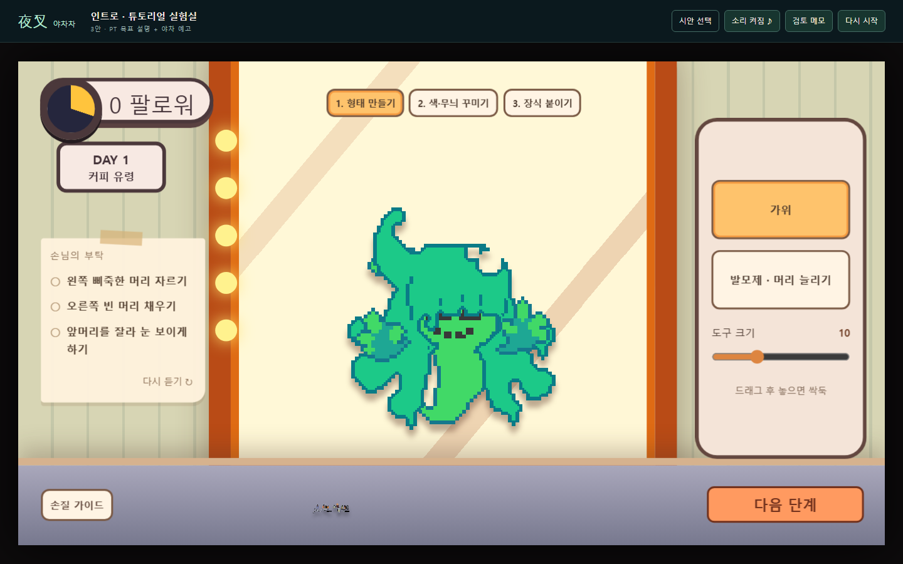
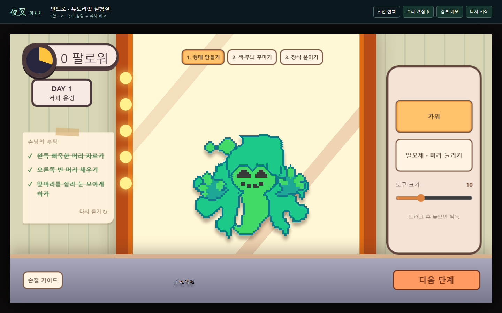

# 커피 유령 최신 머리카락 적용

2026-11-01 · 통합 0.42 리소스 후속

제공받은 T_CoffeeGhost_hair_v2.png 원본을 변경 없이 hair-v2.png로 추가하고 튜토리얼의 머리/미용 재료 연결을 교체했다. 57×61 크기와 기존 배치(46,66,228,244)를 유지한다. 새 파일명으로 이전 PNG 캐시와 구분한다. 기존 hair.png와 완성 목표 hair-complete.png는 보존했다.

원본 SHA-256: 3ca870ac4c9b634b080e07026a5735f48b1e558cf35b1e11c25e366b01a8a6ae

관련 단위 검사 26개와 빌드 통과. Chromium에서 미용 구간 선택으로 진입하여 새 리소스 로딩과 비어 있지 않은 자르기/복원/양쪽 눈 마스크를 확인했다. 실제 마우스로 발모제와 가위를 적용해 세 요구가 모두 완료되고 형태 점수가 40점이 됐다. 전체 튜토리얼/야차/Unity 검증은 이번 범위가 아니다.

