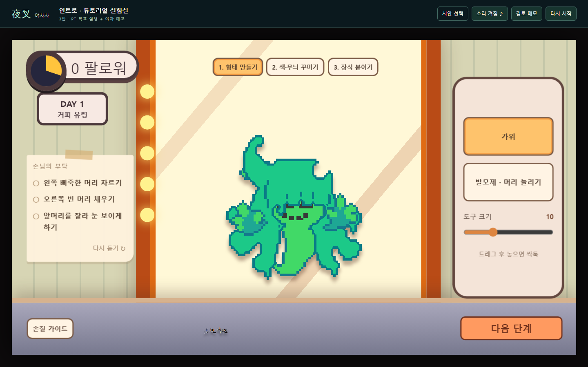
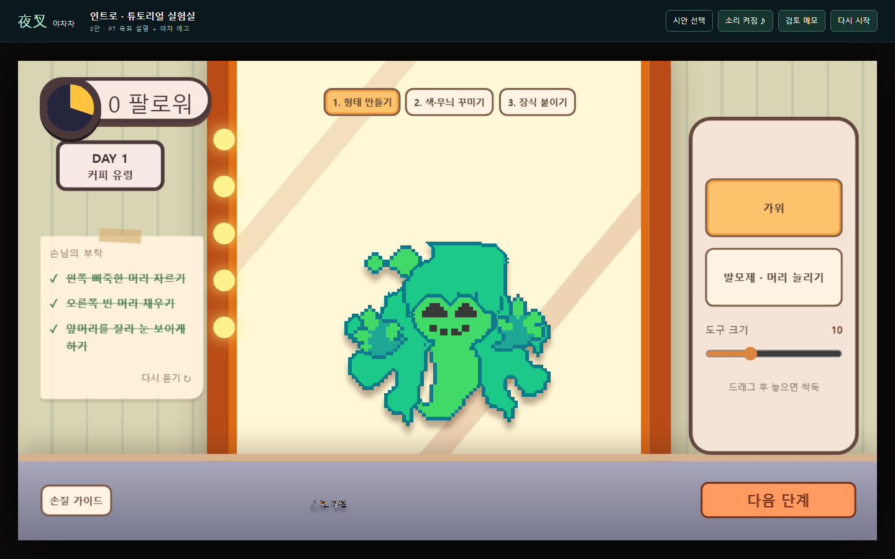

# 커피 유령 머리카락 v3

2026-11-01 · 통합 0.42 리소스 후속

사용자 제공 T_CoffeeGhost_hair_v3.png를 그대로 hair-v3.png에 복사하고 머리/미용 재료의 연결 두 곳을 교체했다. 57×61 크기, 기존 배치, 완성 목표와 점수 규칙을 유지한다. 이전 원화 파일은 보존한다.

원본 SHA-256: d0219d2f748e64db46b641c5c7a4b2b2a40c2d59d3041283007f5a34c043996f

관련 검사 26개와 빌드 통과. Chromium 미용 구간에서 실제 마우스로 발모제/가위를 적용해 왼쪽 머리 자르기·오른쪽 복원·양쪽 눈 노출의 세 요구 완료와 형태40점을 확인했다. 전체 튜토리얼·야차·Unity 검증은 이번 범위가 아니다.

