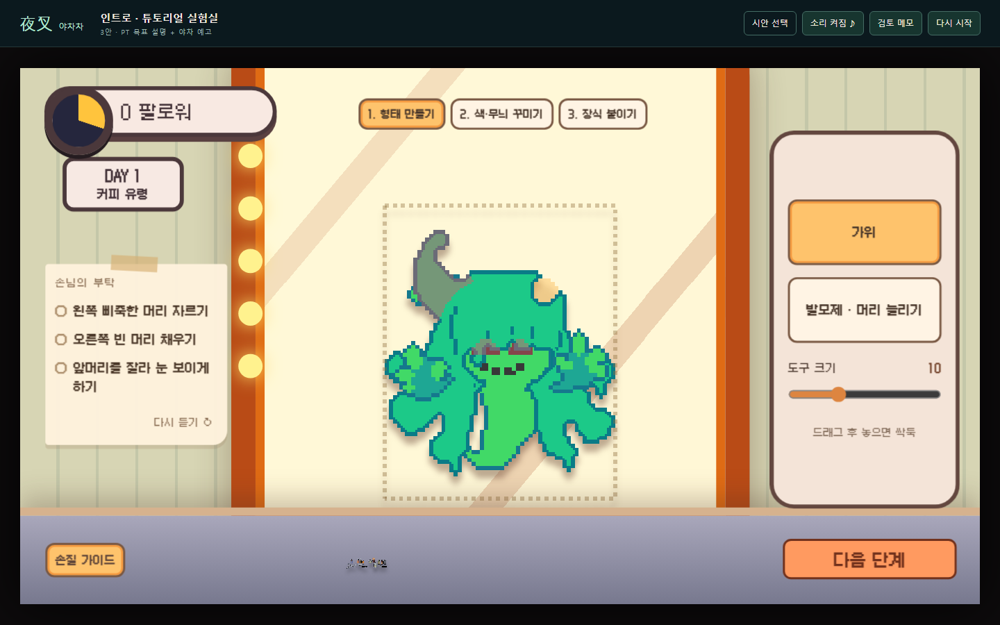
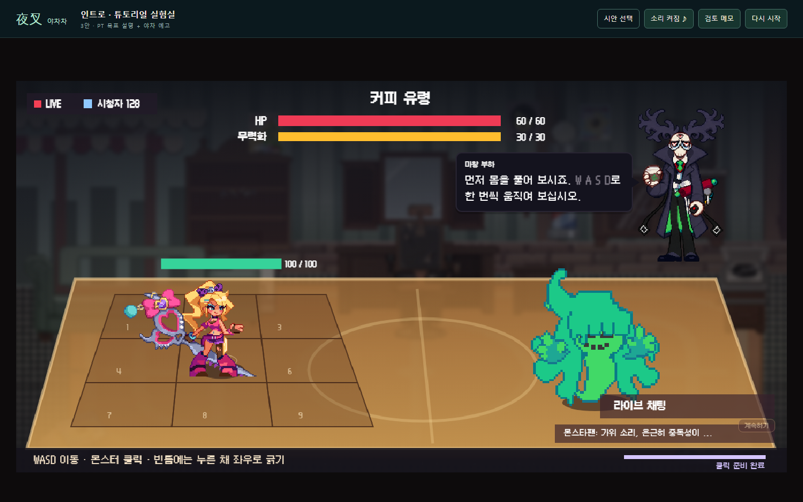
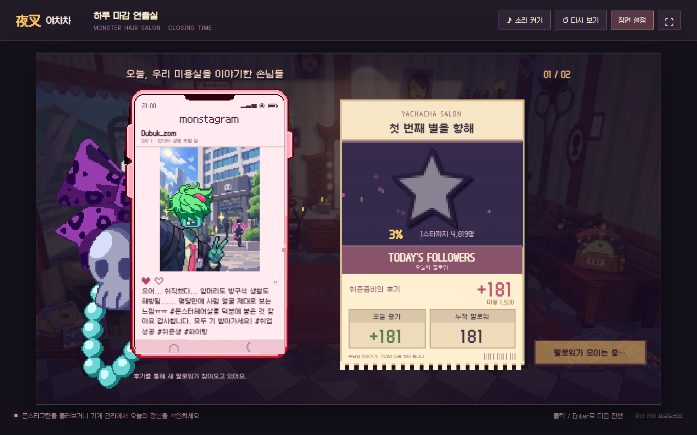
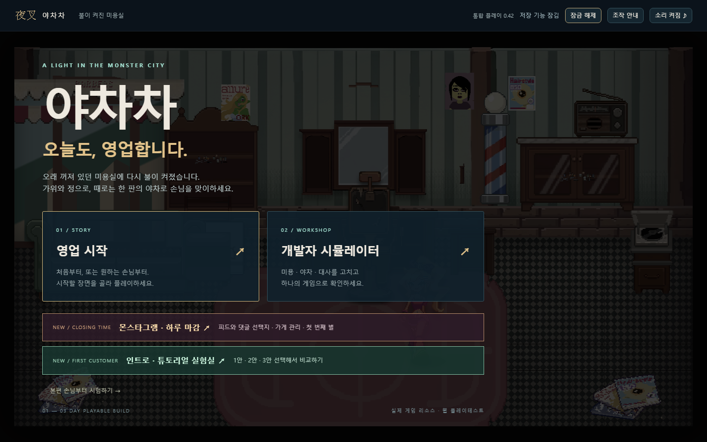

# 인게임 Galmuri9 적용

2026-11-01 · 통합 시뮬레이터 인게임 글꼴 후속

제공한 Galmuri9.woff2 원본을 배포 파일에 포함하고 SIL OFL 1.1 라이선스를 함께 보관했다. 인트로·대사·미용·야차 HUD/피해 숫자·결과 선택·핸드폰·후기·영수증의 텍스트에 적용했다. 메인 화면·개발실·실험실 툴바의 기존 글꼴은 유지한다. 이미지에 들어 있는 글자는 원화 그대로다.

공통 CSS를 실제 플레이 영역에 한정했고 별도 캔버스 글꼴 지정도 변경했다. 야차 시작 전 폰트 로딩을 기다린다. 픽셀 글자 폭으로 팔로워가 줄바꿈되는 것을 확인해 미용 팔로워 영역을 230px/18px 한 줄로 보정했다. 폰트 원본 SHA-256: bea397545086f0d2e3652563746783c679c9f38190a1aecee3c9412c9d6c5d14

빌드와 scripts/check-ingame-font.mjs 통과. Chromium에서 메인/개발실 미적용, 본편 대사·인트로·미용·야차 HUD·결과·가게 관리·영수증 폰트 로딩과 계산된 글꼴을 확인했다. 미용은 1440×900 및 1024×768에서 확인했다. 전체 전투·미용 완주나 Unity/실제 Safari 검증은 이번 범위가 아니다.

